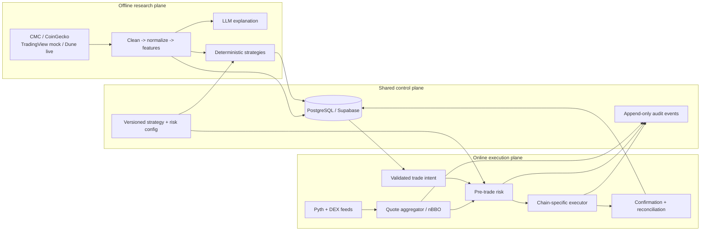

# Trading Agent Architecture

This document defines the target architecture and marks the boundary between
implemented, simulated, and planned behavior. For file-level navigation, see
[CODE_WALKTHROUGH.md](CODE_WALKTHROUGH.md).

## Product Goal

Build a near-real-time quantitative trading engine, not an HFT system.

- The **offline research plane** periodically gathers market data, produces
  features and analysis, and emits advisory signals.
- The **online execution plane** consumes approved strategy signals and live
  market data, applies risk policy, selects an executable route, submits a
  transaction, and independently reconciles its final chain state.
- LLM output may explain or propose trades. It must never bypass deterministic
  strategy, risk, sizing, signing, or confirmation controls.

The practical latency target is seconds, not microseconds. Exact service-level
objectives remain an operator decision in
[OP_Pending_Items.md](OP_Pending_Items.md).

## Current Status

| Capability | Status | Notes |
|---|---|---|
| NestJS API and React dashboard | Implemented | One backend entry point: `backend/src/main.ts` |
| Offline pipeline orchestration | Implemented | Manual or BullMQ scheduled |
| CMC/CoinGecko market data | Partial | Live source with static fallback |
| TradingView ingestion | Simulated | Hard-coded demo rows |
| Dune ingestion | Implemented | Live 24h token buy/sell volume by chain and DEX |
| Data cleaning and normalization | Partial | Normalization is currently a pass-through |
| LLM market summary | Partial | Live when configured, generic mock otherwise |
| Typed decision quality gate | Prototype | Optional JEV adapter; shadow mode by default |
| Offline strategy | Prototype | RSI threshold strategy only |
| Pyth pricing | Partial | Live probe/SSE with automatic mock fallback |
| DEX quote aggregation | Prototype | Jupiter/Raydium/Orca adapters exist; not production validated |
| nBBO and pre-trade risk checks | Implemented prototype | Quote selection and basic limits |
| Solana wallet submission | Not implemented | Jupiter unsigned transaction can be built |
| Transaction confirmation/reconciliation | Not implemented | UI/API can manually set status |
| Injective execution | Experimental | MCP executor or simulated executor |
| Cross-chain arbitrage | Research demo | Bridge cost and mock premium are estimates |
| Anchor guardrail program | Prototype | Compiles; no contract tests or backend integration |
| Authentication, authorization, secrets isolation | Not implemented | Required before public deployment |

No simulated quote, signal, identity, transaction hash, or confirmation is
production evidence.

## System Boundaries



The offline and online planes exchange versioned data through durable storage
or a queue. They must not call each other's internal services directly.

## Online Trade State Machine

The production state machine should be:

```text
PROPOSED -> VALIDATED -> QUOTED -> APPROVED -> SIGNING -> SUBMITTED
          -> CONFIRMED -> FINALIZED
          -> REJECTED | EXPIRED | FAILED | UNKNOWN
```

Rules:

- A client cannot directly choose a later state.
- Every transition is conditional and idempotent.
- `SUBMITTED` requires a real network signature or order hash.
- `CONFIRMED` and `FINALIZED` come from an independent RPC/indexer observer.
- A quote has a source, environment (`live` or `simulated`), observed time,
  slot/block height where available, and expiry.
- Restarting the process resumes reconciliation without submitting twice.

The current `PENDING/READY/SUBMITTED/CONFIRMED/FAILED` database lifecycle is a
demo model and does not yet enforce these rules.

## Online Request Path Today

```text
POST /realtime/trade/prepare
  -> RealtimeService
  -> RealTimeAgentCore
  -> Pyth getLatest
  -> DexOrderBookAggregator
  -> NbboEngine
  -> RiskEngine
  -> optional unsigned Jupiter transaction / Injective plan
  -> RealtimeTradeRepository
  -> Socket.IO event
```

This path prepares a trade. It is not an autonomous trading loop because it
does not consume a strategy event, reserve balances, sign a Solana transaction,
submit it, or verify confirmation.

## Offline Request Path Today

```text
POST /agent/run-pipeline or BullMQ
  -> CoinMarketCap/CoinGecko + TradingView mock + Dune live DEX aggregation
  -> persist raw source rows
  -> cleaner
  -> pass-through normalizer
  -> LLM summary
  -> SimpleMomentumStrategy
  -> optional typed decision quality gate
  -> persist analysis with gate metadata
  -> persist approved signals
  -> Socket.IO event
```

The same run can contain observations from different timestamps and sources.
Before signals are actionable, the pipeline needs point-in-time joins,
feature versioning, data quality gates, backtests, and signal expiry.

## Component Ownership

| Area | Canonical code |
|---|---|
| Runtime composition | `backend/src/app.module.ts`, `backend/src/main.ts` |
| Offline orchestration | `backend/src/scheduler/` |
| Ingestion | `backend/src/crawlers/` |
| Cleaning/features | `backend/src/data/` |
| Research and signals | `backend/src/agents/`, `backend/src/decision/`, `backend/src/strategy/` |
| Live market access | `backend/src/oracle/`, `backend/src/dex/` |
| Quote/risk orchestration | `backend/src/agent/realtime-agent-core.ts` |
| API, persistence, events | `backend/src/realtime/` |
| Chain execution helpers | `backend/src/transactions/` |
| Durable schema | `backend/prisma/schema.prisma` |
| Solana guardrail prototype | `contracts/programs/trade_execution/` |
| Operator UI | `frontend/src/` |

## Safety Invariants

1. Core token amounts remain integers (`bigint`, `u64`, or `u128`).
2. Simulated data is explicitly labeled and cannot reach a live executor.
3. A risk policy is versioned and attached to every decision.
4. Quotes expire; stale prices and stale block context fail closed.
5. Signing credentials are isolated from public API and LLM processes.
6. Submission uses an idempotency key and durable outbox.
7. Confirmation is observed, never accepted from an unauthenticated client.
8. The LLM can explain a deterministic result but cannot create authority.

## Deployment Shape

The current monolithic NestJS process is appropriate through the prototype
stage. Split services only when the data and execution contracts are stable:

1. `research-worker`: scheduled ingestion, features, backtests, signals.
2. `market-data`: persistent subscriptions and normalized live snapshots.
3. `execution-engine`: intents, quotes, risk, signing handoff, state machine.
4. `reconciler`: chain/indexer observation and portfolio reconciliation.
5. `api`: authenticated operator control and read models.

Use PostgreSQL as the source of truth. Redis/BullMQ may schedule work but must
not be the only record of a trade.

## Delivery Roadmap

### Packet 0: Truthful prototype

- Keep one backend runtime and one route per capability.
- Label all live, fallback, and simulated data in types and UI.
- Fail closed in live execution mode when oracle or DEX data is unavailable.
- Add API authentication before exposing write endpoints.

### Packet 1: Research foundation

- Replace the mock TradingView input or remove it.
- Implement point-in-time normalized candles and feature versions.
- Add backtest, walk-forward evaluation, fees, slippage, and signal expiry.
- Promote signals only after deterministic acceptance criteria pass.

### Packet 2: Paper-trading engine

- Add a strategy event contract and portfolio/position ledger.
- Add state-machine transition guards, idempotency, and durable audit events.
- Run continuously against live data with a simulated executor.
- Measure quote, decision, submission, and reconciliation latency.

### Packet 3: Solana testnet execution

- Integrate wallet signing, simulation, submission, retry, and confirmation.
- Add RPC fallback, blockhash refresh, priority fees, and balance reservation.
- Add Anchor tests before using the guardrail program.

### Packet 4: Limited production

- Add kill switches, per-strategy capital limits, alerts, and runbooks.
- Start with one pair, one venue/aggregator, and small capped notional.
- Expand only after reconciliation and failure metrics are reliable.

Cross-chain execution should follow single-chain reliability, not precede it.

## Related Documents

- [CODE_WALKTHROUGH.md](CODE_WALKTHROUGH.md)
- [offline-agent-design.md](offline-agent-design.md)
- [realtime-agent-design.md](realtime-agent-design.md)
- [OP_Pending_Items.md](OP_Pending_Items.md)
- [MANUAL.md](MANUAL.md)
