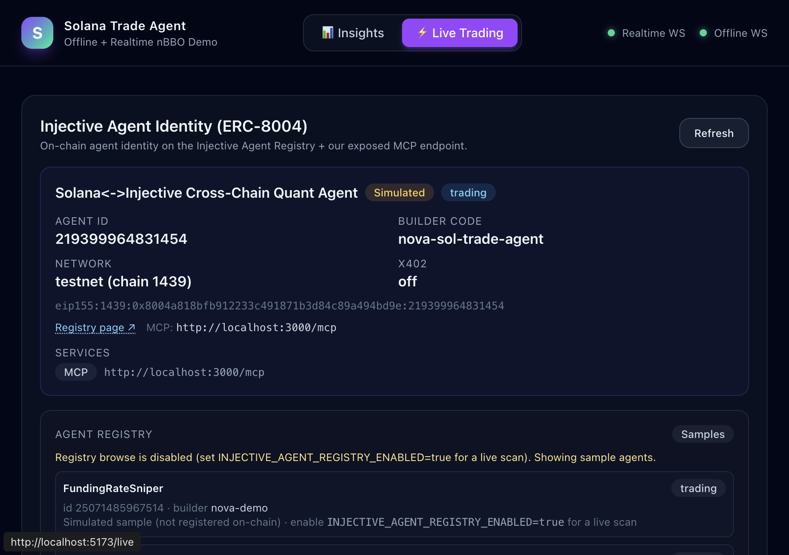
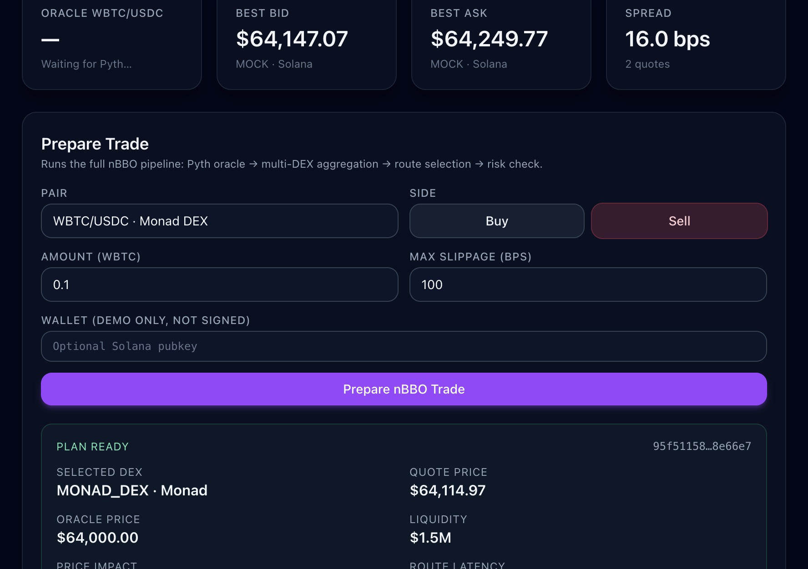
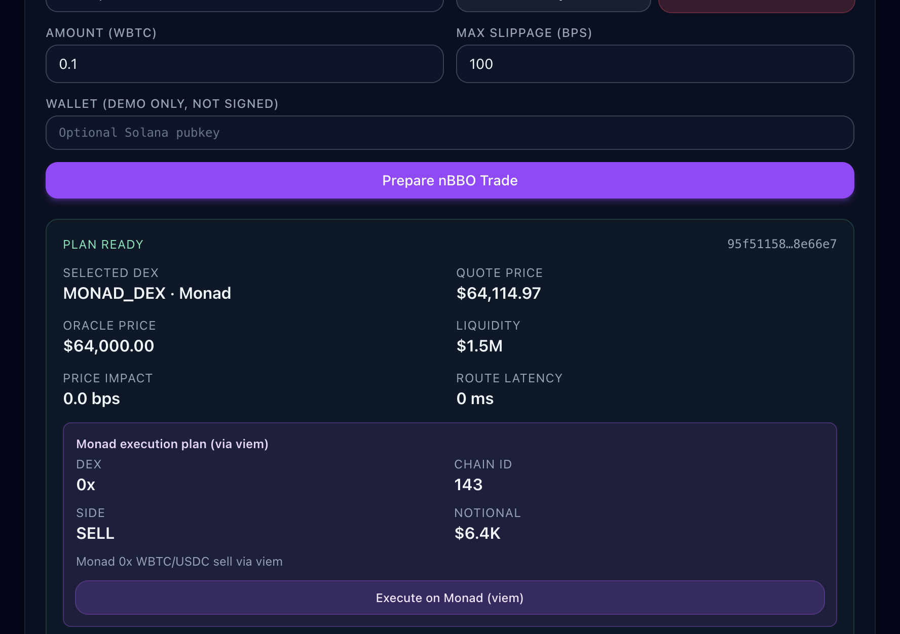
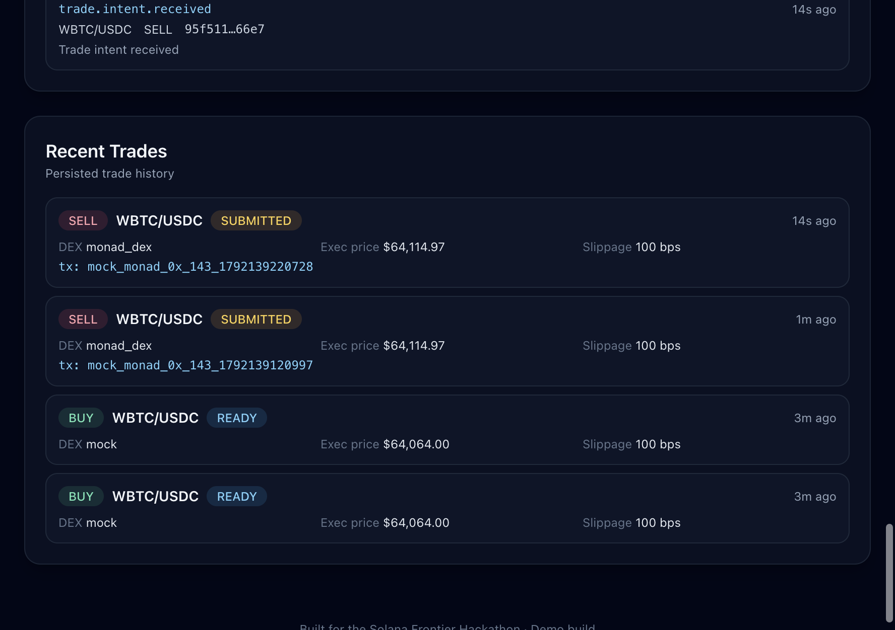

# Monad Chain Walkthrough — End-to-End Demo (Zero Keys)

This walkthrough runs the **full Monad trading flow** against a live local stack in
**mock mode** — no paid API keys, no real signing, no real funds. It demonstrates
every link in the chain that was built in tickets M-01..M-08:

> Pyth oracle → multi-DEX aggregation (incl. `monad_dex`) → nBBO route selection →
> deterministic risk gate → `MonadExecutionPlan` → viem signer (mock) → persisted
> `RealtimeTrade(status=SUBMITTED)` + WebSocket lifecycle event.

All screenshots below were captured from a real running stack
(`ENABLE_MONAD=true MONAD_DEX_MODE=mock MONAD_PRIVATE_KEY=""`).

---

## 0. What you need

- Local Postgres + Redis (Docker is fine — see `README.md` Quickstart).
- Backend built: `cd backend && npm install && npm run db:generate && npm run db:push && npm run build`.
- Frontend deps: `cd frontend && npm install`.
- The `uuid-ossp` extension if you use a plain Postgres container:
  `docker exec <pg> psql -U postgres -c 'CREATE EXTENSION IF NOT EXISTS "uuid-ossp";'`

> ⚠️ The `MONAD_TOKENS` ERC-20 addresses are **partially verified**: `WMON`
> (`0x32d31642963c202C68724beA3A8dEceb735fca23`) is confirmed; `USDC`/`USDT`/
> `WBTC`/`WETH` remain `0xMONAD...` placeholders. Mock mode bypasses them, so the
> demo is safe. Do **not** enable `MONAD_DEX_MODE=aggregator` or set a real
> `MONAD_PRIVATE_KEY` until the remaining addresses are verified.

---

## 1. Start the stack

```bash
# 1) Postgres + Redis (one-time)
docker run -d --name sol-pg  -p 54322:5432 -e POSTGRES_PASSWORD=postgres postgres:16-alpine
docker exec sol-pg psql -U postgres -c 'CREATE EXTENSION IF NOT EXISTS "uuid-ossp";'
docker run -d --name sol-redis -p 6379:6379 redis:7-alpine

# 2) Backend — Monad enabled, mock mode, no key
cd backend
ENABLE_MONAD=true MONAD_DEX_MODE=mock MONAD_PRIVATE_KEY="" PYTH_USE_MOCK=true \
  node dist/main          # http://localhost:3000

# 3) Frontend
cd ../frontend
npm run dev               # http://localhost:5173
```

Verify the backend wired Monad in — the startup log should show:

```
[RealtimeService] MONAD_PRIVATE_KEY not set — using MockMonadTradeExecutor (no real signing)
[RealtimeService] Realtime agent initialised (realDex=false, injective=true, monad=true,
  pairs=...,MON/USDC,WBTC/USDC,WETH/USDC)
```

`monad=true` and the three Monad pairs (`MON/USDC`, `WBTC/USDC`, `WETH/USDC`)
confirm tickets M-01 (config) + M-02 (token registry) + M-05 (wiring) are live.

---

## 2. Open the Live Trading page

Open <http://localhost:5173/live>. The top-right **Realtime WS** indicator turns
green. The **Cross-Chain Arbitrage Scanner** subtitle now reads
**"Solana ↔ Injective ↔ Monad spread detection (BTC, ETH)"** — the N-chain
generalization from M-06.



The pair dropdown now contains three extra entries tagged **Monad DEX**
(M-07 frontend work): `MON/USDC`, `WBTC/USDC`, `WETH/USDC`.

---

## 3. Pick the Monad pair & prepare a trade

1. Select **`WBTC/USDC · Monad DEX`** from the dropdown.
2. Choose **Sell** (see note below).
3. Enter amount **`0.1`** (WBTC) and max slippage **`100`** bps.
4. Click **Prepare nBBO Trade**.

> **Why Sell?** In mock mode the generic `OracleMockAdapter` labels every pair
> `chain:"solana"` and tracks the Pyth mid with no premium, while the
> `MonadDexAdapter` (M-03) adds a `MONAD_MOCK_OFFSET_BPS=30` premium. For a
> **buy** the nBBO picks the *lowest ask* — Solana wins (no premium). For a
> **sell** the nBBO picks the *highest bid* — Monad wins (its 30 bps premium
> lifts the bid above Solana's). So a sell routes to the Monad executor.

The nBBO panel for `WBTC/USDC` shows the BTC market (~$64,147 bid / $64,249 ask).
After Prepare, a green **PLAN READY** card appears with the routed quote:



Key fields confirming the Monad route (M-05 routing + M-04 plan shape):

| Field | Value | Meaning |
|---|---|---|
| **Selected DEX** | `MONAD_DEX · Monad` | nBBO selected the Monad adapter (M-03) |
| **Quote price** | `$64,114.97` | Monad mock bid = mid × (1+30bps) × (1−12bps) |
| **Oracle price** | `$64,000.00` | Pyth BTC mid (mock) |
| **Monad execution plan (via viem)** | DEX `0x`, Chain id `143`, Side `SELL`, Notional `$6.4K` | `MonadExecutionPlan` from M-01/M-04 |

The **"Monad execution plan (via viem)"** sub-card is the `monadExecutionPlan`
field on `TradeExecutionPlan` — built by `RealTimeAgentCore.buildMonadPlan` (M-05)
and surfaced in the UI by M-07.

---

## 4. Execute on Monad (viem)

Click **Execute on Monad (viem)**. The button shows "Submitting via viem…"
while the `MockMonadTradeExecutor` (M-04) synthesizes a transaction.



The executor returns a simulated tx hash and the service:

1. Persists the trade as `RealtimeTrade(status=SUBMITTED)` (M-05
   `executeMonadTrade`).
2. Emits a `trade.submitted` WebSocket lifecycle event.

---

## 5. Confirm the result

The **Trade Event Feed** streams the full lifecycle in order:

```
trade.intent.received  →  trade.plan.ready  →  trade.submitted
```

The `trade.submitted` event message reads
**"Simulated Monad 0x sell on chain 143"** — proof the Monad executor (M-04)
ran and the event was broadcast over the realtime WS namespace (M-05).

The **Recent Trades** list (persisted to Postgres) shows the new row:



```
SELL WBTC/USDC  SUBMITTED  DEX monad_dex  Exec price $64,114.97
  tx: mock_monad_0x_143_1792139220728
```

The `monad_dex` source tag and the `mock_monad_0x_143_...` tx hash confirm the
trade went through the Monad path end-to-end (adapter → nBBO → plan → executor →
repository → WS).

---

## 6. (Optional) Verify via curl

```bash
# nBBO for the Monad pair
curl -s 'http://localhost:3000/realtime/market/nbbo?pair=WBTC/USDC' | jq '.pair.chain, .bestBid.chain'

# Prepare a sell (routes to Monad)
curl -s -X POST http://localhost:3000/realtime/trade/prepare \
  -H 'content-type: application/json' \
  -d '{"pair":"WBTC/USDC","side":"sell","amountIn":"10000000","maxSlippageBps":100}' \
  | jq '.tradeId, .plan.selectedRoute.quote.chain, .plan.monadExecutionPlan'

# Execute it
curl -s -X POST http://localhost:3000/realtime/trade/monad-execute \
  -H 'content-type: application/json' \
  -d "{\"tradeId\":\"<tradeId from above>"}' | jq '.txHash, .status'
```

Expected: `pair.chain == "monad"`, `selectedRoute.quote.chain == "monad"`,
`monadExecutionPlan.chainId == 143`, `txHash` starts with `mock_monad_0x_143_`,
`status == "simulated"`.

---

## 7. Cross-chain arbitrage (Solana ↔ Injective ↔ Monad)

The **Cross-Chain Arbitrage Scanner** runs the N-chain pairwise scan (M-06).
With the default mock premiums it surfaces Solana↔Injective BTC/ETH spreads
(~60 bps spread, ~25 bps bridge, ~35 bps net edge):

```
BTC net 35.0 bps  Solana mid $64,006.40  Injective mid $64,390.44
  Buy on solana, sell on injective · deBridge: solana -> injective
```

A Solana↔Monad signal appears when the Monad mid diverges enough to clear
`minNetEdgeBps + bridgeCostBps`; with the 30 bps Monad premium the Solana→Monad
edge is ~4 bps net, below the default threshold, so the scanner correctly
suppresses it until premiums widen.

---

## How the tickets map to this flow

| Step in walkthrough | Ticket |
|---|---|
| `monad` config + `ENABLE_MONAD` flag | M-01 |
| `WBTC/USDC · Monad DEX` pair in dropdown | M-02 (registry) + M-07 (UI) |
| nBBO surfaces a `monad_dex` quote | M-03 (adapter) + M-05 (wiring) |
| `monadExecutionPlan` card (chain 143, 0x, viem) | M-01 (type) + M-04 (executor) + M-05 (routing) |
| **Execute on Monad (viem)** button | M-07 (UI) |
| `trade.submitted` event + persisted `SUBMITTED` trade | M-04 (mock executor) + M-05 (service) |
| N-chain arb scanner (Solana ↔ Injective ↔ Monad) | M-06 (strategy) + M-07 (UI) |
| This doc + the e2e integration test | M-08 |

---

## Turning on real execution (OP decision gates)

Before flipping `MONAD_DEX_MODE=aggregator` or setting a real `MONAD_PRIVATE_KEY`,
clear these gates (see `docs/monad-integration-roadmap.md`):

1. **Pyth MON feed** — confirm a published Pyth price feed id for Monad-native assets.
2. **Paid Monad RPC** — provision a paid/mainnet `MONAD_RPC_URL`.
3. **0x / 1inch API key** — obtain `MONAD_AGGREGATOR_API_KEY` for aggregator mode.
4. **Verified ERC-20 addresses** — `WMON` is done; replace the remaining
   `0xMONAD...` placeholders in `MONAD_TOKENS` (USDC/USDT/WBTC/WETH).
5. **Funded signer** — fund the EVM address from `MONAD_PRIVATE_KEY` with MON for gas.

None of these are required for the zero-key demo above.
