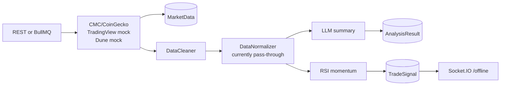

# Offline Research Agent Design

The offline agent is a scheduled research pipeline. Its output is market
analysis and expiring trade advice, not direct execution authority.

See [ARCHITECTURE.md](ARCHITECTURE.md) for the system boundary and
[CODE_WALKTHROUGH.md](CODE_WALKTHROUGH.md) for file-level navigation.

## Current Pipeline



Canonical orchestration: `backend/src/scheduler/offline-agent.service.ts`.

## Responsibilities

The offline plane should own:

- historical and slower-moving data ingestion;
- point-in-time data quality and normalization;
- deterministic feature calculation;
- backtesting and walk-forward evaluation;
- strategy parameter research;
- advisory signal generation with provenance and expiry;
- human-readable LLM summaries.

It should not own:

- wallet keys or transaction signing;
- live order submission;
- authoritative portfolio balances;
- final pre-trade risk;
- transaction confirmation.

## Current Limitations

1. TradingView and Dune inputs are hard-coded.
2. Source rows are persisted before cleaning, so the database is a raw
   observation store rather than a normalized research dataset.
3. Rows from different sources are not joined by a point-in-time rule.
4. Normalization and feature engineering are not implemented.
5. The only strategy is an RSI threshold on rows containing both price and RSI.
6. LLM output is generic prose and is not consumed by the deterministic
   strategy.
7. Signals do not have expiry, feature version, dataset version, or backtest
   evidence.
8. `BacktestResult` and `CrawlerJob` exist in Prisma but are not used.

## Target Data Contract

An actionable research signal should contain:

```text
signal_id
strategy_id + strategy_version
dataset_version + feature_version
instrument
direction
generated_at + valid_until
reference_price + source timestamp
confidence or score with defined semantics
suggested size/risk budget
reason codes
backtest/evaluation reference
environment: research | paper | live-approved
```

Text generated by an LLM may accompany this record, but cannot replace it.

## Target Pipeline

```text
ingest raw observations
  -> validate schema and source health
  -> normalize instruments and timestamps
  -> point-in-time join
  -> calculate versioned features
  -> run deterministic strategy
  -> apply research quality gates
  -> persist expiring advisory signal
  -> publish signal event
```

Use append-only raw observations and derived versioned datasets. Re-running the
same pipeline version over the same input should produce the same signal.

## Acceptance Criteria

Before the online engine may consume offline signals:

- no simulated source is present;
- the signal has not expired;
- every feature has an observation timestamp at or before decision time;
- fees, spread, slippage, and latency are included in evaluation;
- backtest and walk-forward thresholds pass;
- strategy and configuration versions are immutable and traceable;
- signal generation is idempotent.

## Delivery Packets

### Offline Packet A: Data truth

- Replace hard-coded sources with real adapters or delete them.
- Add source health and explicit provenance.
- Store normalized candles/snapshots separately from raw source rows.

### Offline Packet B: Research quality

- Implement versioned features.
- Add backtest and walk-forward runners.
- Model fees, slippage, delayed entry, and signal expiry.

### Offline Packet C: Signal contract

- Persist the target signal contract.
- Publish accepted signals through a durable outbox.
- Add operator review and promotion from research to paper mode.
