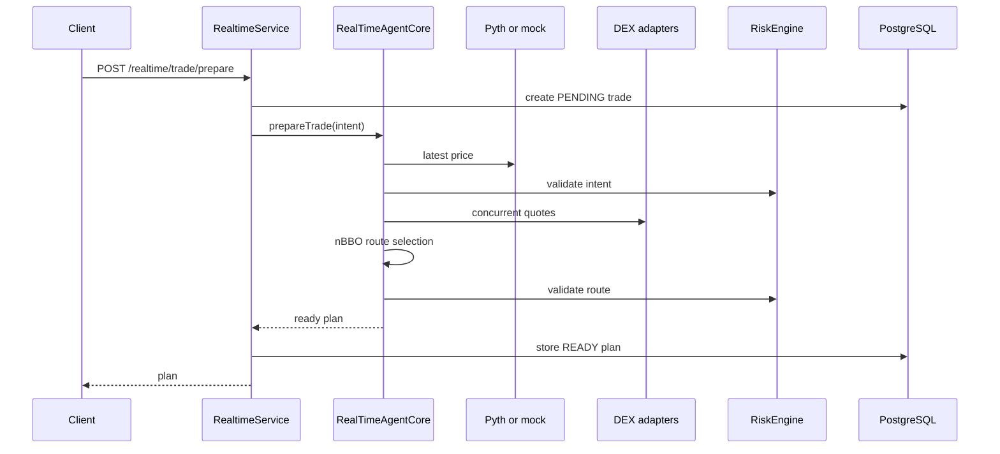

# Near-Real-Time Execution Engine Design

The online engine targets decision and execution latency measured in seconds.
It is not intended for colocated HFT or market making.

See [ARCHITECTURE.md](ARCHITECTURE.md) for the system boundary and
[CODE_WALKTHROUGH.md](CODE_WALKTHROUGH.md) for file-level navigation.

## Current Prepare Flow



This produces a plan. It does not currently complete a trustworthy Solana
execution lifecycle.

## Target Modules

### Market data

- Maintain persistent Pyth and venue subscriptions.
- Record source, environment, observation time, and slot/block context.
- Detect stale, crossed, missing, and divergent markets.
- Reconnect with heartbeat, backoff, and endpoint fallback.

### Signal intake

- Consume versioned, expiring strategy signals.
- Deduplicate by signal and strategy version.
- Translate advice into a trade intent using portfolio and sizing policy.
- Reject research-only and simulated signals in live mode.

### Quote and route

- Request executable quotes for the exact amount.
- Compare net output after venue fee, priority fee, and estimated slippage.
- Require quote expiry and venue health.
- Prefer one aggregator integration initially; add direct venues only after
  their execution and accounting are tested.

### Risk

Current checks cover pair, amount, slippage, oracle age, liquidity, impact, and
oracle deviation. Production also needs:

- available balance and reserved funds;
- current position and concentration;
- open orders and duplicate intent detection;
- realized/unrealized PnL and daily loss;
- strategy capital allocation;
- volatility and market-health circuit breakers;
- operator and global kill switches.

### Execution

- Build and simulate the transaction.
- Sign in an isolated wallet process or custody service.
- Submit with an idempotency key.
- Refresh blockhash and priority fee without changing economic constraints.
- Never retry blindly after an ambiguous network response.

### Reconciliation

- Independently query RPC/indexer for signature or order status.
- Track `SUBMITTED`, `CONFIRMED`, and `FINALIZED` separately.
- Reconcile fills, fees, balances, and positions.
- Resume unresolved trades after process restart.
- Alert on `UNKNOWN` or accounting mismatch.

## Required State Machine

```text
PROPOSED
  -> VALIDATED
  -> QUOTED
  -> APPROVED
  -> SIGNING
  -> SUBMITTED
  -> CONFIRMED
  -> FINALIZED

Terminal/error states:
REJECTED, EXPIRED, FAILED, UNKNOWN
```

Only server-side commands and chain observations may transition state. The
current `POST /realtime/trade/confirm` endpoint is demo-only and must be removed
or restricted to a simulated executor.

## Live vs Simulated Mode

Mode must be explicit on every object, not inferred from environment:

```text
MarketObservation.environment
DexQuote.environment
TradeSignal.environment
ExecutionPlan.environment
Trade.environment
```

Rules:

- A live plan may contain only live observations and quotes.
- Oracle or venue failure in live mode fails closed.
- A mock transaction hash can never produce `CONFIRMED`.
- The UI must visibly distinguish simulated and live modes.

## Solana First

The shortest path to a reliable engine is:

1. One pair, such as `SOL/USDC`.
2. Pyth plus Jupiter executable quotes.
3. Paper executor and full reconciliation model.
4. Devnet/testnet signing and confirmation.
5. Small capped mainnet notional.
6. Additional direct DEX adapters.
7. Injective and cross-chain inventory.

Cross-chain arbitrage is not one atomic route. It requires pre-funded
inventory, two-leg execution, bridge/rebalancing logic, and additional risk
controls.

## Contract Role

The Anchor program may become an optional on-chain policy/audit guard. Today it
is disconnected from the backend and validates a reported result rather than
performing DEX CPI. Integrate it only after:

- account constraints and state sizing are tested;
- `limit_price` is enforced or removed;
- replay/idempotency behavior is defined;
- Anchor unit/integration tests pass;
- its value over backend risk plus wallet policy is demonstrated.

## Observability

Measure at least:

- feed age and reconnect count;
- quote success, latency, and rejection reason by venue;
- decision duration;
- simulation and submission latency;
- confirmation/finalization latency;
- slippage against quoted and oracle price;
- failed, expired, and unknown trades;
- position and PnL reconciliation mismatch.

Logs must include `tradeId`, `signalId`, strategy/config version, quote ID, and
chain signature without exposing credentials.
